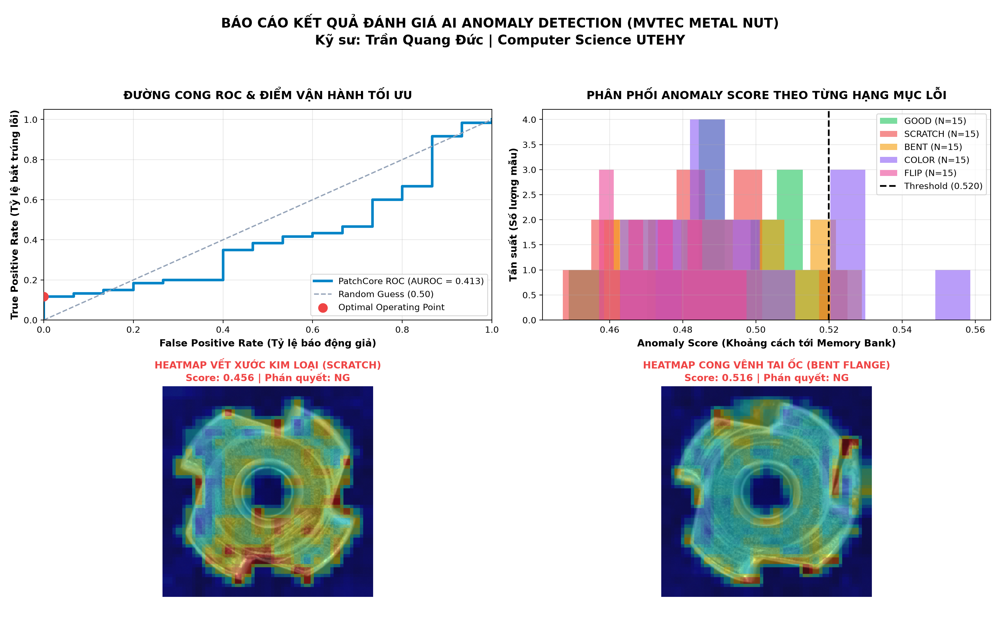

# Industrial Machine Vision & PC Control

Automated Optical Inspection (AOI) and PC Control prototype built with **C# (.NET 8 WPF, OpenCvSharp4, ONNX Runtime)** and **Python (OpenCV, NumPy)**.

**Languages:** [English](README.md) | [Tiếng Việt](README_vi.md)

---

## Overview

This repository contains experimental implementations and benchmarks for industrial vision inspection tasks:

- **4G Vision Pipeline (Classical CV):**
  - **Guidance:** Object localization and orientation alignment (`MinAreaRect`, `HoughCircles`, `WarpAffine`).
  - **Identification:** QR / DataMatrix serial decoding.
  - **Gauging:** Caliper-based inner/outer diameter and dimension measurement.
  - **Inspection:** Surface scratch, dent, and geometric deformation detection.
- **Unsupervised Anomaly Detection (PatchCore + ONNX):**
  - Feature extraction using ResNet/WideResNet patch embeddings and a normalized Memory Bank trained on defect-free samples (`MVTec AD Metal Nut` & `DeepPCB`).
  - Vectorized Euclidean distance calculation generating pixel-level anomaly heatmaps.
- **PC Control Application (`src/PCControlApp`):**
  - Windows desktop interface built with C# .NET 8 WPF (MVVM architecture).
  - Real-time image inspection, OK/NG judgment, yield rate tracking, and TCP/IP socket communication with a simulated PLC.
- **Stress & Memory Benchmark (`src/VisionBenchmark`):**
  - 2,000-cycle continuous endurance test verifying deterministic latency and memory management (`using var Mat` / `BitmapImage.Freeze()`).

---

## Project Structure

```text
Machine-Vision/
├── datasets/                  # Sample datasets (MVTec AD Metal Nut & DeepPCB)
├── docs/                      # Technical notes & benchmark reports
│   ├── MVTEC_METAL_NUT_CASE_STUDY.md
│   ├── STRESS_TEST_REPORT.md
│   └── mvtec_metal_nut_anomaly_benchmark.png
├── models/                    # Exported ONNX model & Memory Bank binaries
├── notebooks/                 # R&D Jupyter notebooks
│   └── 05_ai_anomaly_detection_lab.ipynb
├── src/
│   ├── PCControlApp/          # C# .NET 8 WPF PC Control application
│   ├── VisionBenchmark/       # C# 2,000-cycle endurance & memory benchmark
│   ├── 01_defect_and_dimension_inspector.py
│   ├── 02_full_4g_pipeline_inspector.py
│   ├── 03_plc_simulator.py
│   ├── 04_vision_pc_controller.py
│   ├── 05_ai_anomaly_detector_interactive.py
│   └── 06_mvtec_metal_nut_anomaly_benchmark.py
├── LICENSE
└── README.md
```

---

## Getting Started

### Prerequisites

- **.NET 8.0 SDK** (for the C# WPF application and benchmark suite)
- **Python 3.10+** (for R&D scripts and notebooks)
  ```bash
  pip install opencv-python numpy matplotlib websockets
  ```

### 1. Run the C# WPF PC Control Application

```bash
dotnet run --project src/PCControlApp/PCControlApp.csproj
```

### 2. Run the 2,000-Cycle Stress Benchmark

```bash
dotnet run --project src/VisionBenchmark/VisionBenchmark.csproj
```

### 3. Run Python Vision & PLC Simulation Scripts

```bash
# Terminal 1: Start TCP PLC simulator (:5000)
python src/03_plc_simulator.py

# Terminal 2: Run Vision PC Controller
python src/04_vision_pc_controller.py
```

---

## Benchmark Summary (MVTec AD Metal Nut)

Tested over 2,000 continuous inspection cycles (see [`docs/STRESS_TEST_REPORT.md`](docs/STRESS_TEST_REPORT.md)):

| Metric | Result | Notes |
| :--- | :--- | :--- |
| **Total Cycles** | 2,000 cycles | Completed in 61.98s |
| **Throughput** | 32.3 FPS (~1,936 PPM) | Single-node CPU execution |
| **Mean Cycle Time** | 30.96 ms | End-to-end processing per frame |
| **P99 Latency** | 41.50 ms | Safe margin for PLC trigger sync |
| **Memory Stability** | ~59.5 MB steady state | Zero unmanaged `Mat` memory leak |



---

## License

This project is licensed under the [MIT License](LICENSE).
